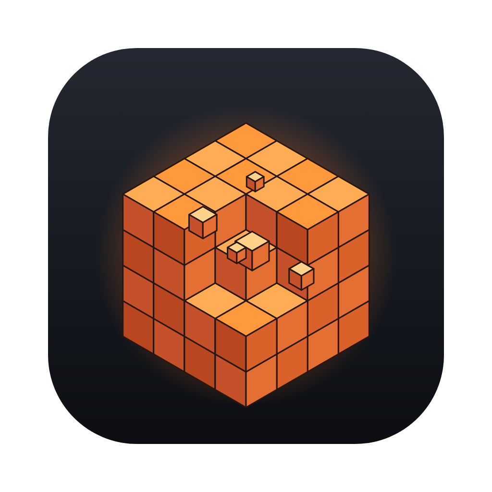

# Breakpoint

A fully destructible voxel heist game for macOS, inspired by Teardown. Every wall is a door: plan your route through a town where everything breaks, then grab the loot and reach the getaway van before the police arrive.



## Get the Mac app

1. Open the repository's **Actions** tab → the latest **Mac app** run → download the **Breakpoint-macOS** artifact.
   Tagged versions (`v*`) also attach the `.dmg` files to a GitHub Release.
2. Open `Breakpoint-<version>-arm64.dmg` (Apple Silicon) or `-x64.dmg` (Intel) and drag **Breakpoint** into Applications.
3. **First launch:** the app is ad-hoc signed, not notarised (that needs a paid Apple Developer account), so macOS will refuse to open it the first time. Either:
   - open **System Settings → Privacy & Security**, scroll down and click **Open Anyway**, or
   - run `xattr -dr com.apple.quarantine /Applications/Breakpoint.app` once in Terminal.

## How to play

You start in the **planning phase** with no clock: walk the town, blow holes, cut paths, stack things. The moment you grab a piece of loot (or set off the fire alarm by letting more than 200 voxels burn), a **60-second alarm** starts. Collect the three required items (blue markers), optionally the two bonus items (orange), then get into the green ring behind the red van.

| Loot | Where | How |
| --- | --- | --- |
| Ledger | Brick townhouse, top floor | Stairs, or make your own entrance |
| Server Drive | Office tower, 4th floor | Stairs, or a faster way up |
| Gold Bars | Bank vault | Sealed in steel: cutter, rockets or bombs |
| Antique Clock (bonus) | Barn hayloft | Stairs inside the barn |
| Radio Beacon (bonus) | Top of the water tower | Unreachable; bring the tower down |

**Controls**

| | |
| --- | --- |
| Move / sprint / jump / crouch | `WASD` · `Shift` · `Space` · `C` |
| Use tool | Left click (hold for cutter and extinguisher) |
| Carry / throw objects | Right click or `Q` to hold, left click to throw |
| Switch tool | `1`–`6` or mouse wheel |
| Grab loot | `E` |
| Pause | `Esc` |

**Tools:** sledgehammer (soft materials and some brick), shotgun (shreds glass, wood and plaster), pipe bombs (3 s fuse, bounce), rockets (breach steel), plasma cutter (cuts anything, limited fuel), extinguisher (put out fires before they trip the alarm).

## What's under the hood

- **Voxel world:** 256×64×256 voxels at 25 cm (64 m × 16 m × 64 m) with 27 materials and three hardness tiers. The town is generated from a seed ("New town" picks a different one).
- **Structural collapse:** after every hit, a flood fill finds anything that lost its connection to the ground and turns it into a rigid body.
- **Physics:** [Rapier](https://rapier.rs) (WebAssembly, SIMD) with native voxel colliders. Debris collides with the world and with other debris, stacks and sleeps. Hard impacts crack pieces further, and heavy pieces crush what they land on. You can pick up and throw light objects.
- **Fire:** wood, leaves and fabric burn, spread upwards and char or crumble, which can bring floors down.
- **Rendering:** three.js on WebGL 2, which runs on Metal on macOS. Highlights:
  - physically based materials with per-voxel roughness and metalness, baked ambient occlusion and bevelled voxel edges
  - sky-based image lighting, soft shadows, and height fog that picks up the sun's colour
  - 4× MSAA HDR rendering with bloom, so fire, sparks and freshly cut steel glow and cool down
  - smoke, dust, embers and dynamic fire and explosion lights
- **Tuned for Apple Silicon:**
  - MSAA instead of post-process anti-aliasing (cheap on tile-based GPUs)
  - shadow maps that re-render only when something moves
  - dynamic resolution to hold frame rate on Retina displays
  - chunk meshing on a worker pool across the CPU cores
  - fixed 60 Hz physics with interpolation, so motion stays smooth on 120 Hz ProMotion screens
- **Audio:** everything is synthesised at runtime, with 3D positional sound and an outdoor reverb.

The desktop app is a thin Electron shell (`electron/main.cjs`) that serves the game from a private `app://` origin. No server or network is used.

## Develop

Requires Node 22. The game itself has no runtime dependencies; three.js and Rapier are vendored in `vendor/`.

```sh
npm install        # Electron + electron-builder (dev only)
npm start          # dev server at http://localhost:5173 (any modern browser)
npm run app        # run the desktop app from source
npm test           # unit + physics tests (Node, headless)
npm run smoke      # plays a scripted mission in headless Chromium (needs Playwright)
npm run selftest   # boots the desktop app, triggers an explosion, checks for errors
npm run dist:mac   # build the .dmg (on a Mac; CI does this on every push)
```

Graphics presets live in the main menu. Auto picks **High** on Apple GPUs; **Ultra** adds ground-truth ambient occlusion (GTAO). The small grey line in the top-right of the HUD shows fps, CPU time per frame, render scale, active debris bodies and fires.

## Limitations

- It is not Teardown. There is no ray-traced lighting, no water, no vehicles and only one handcrafted mission layout, though the town can be reseeded.
- Graphics and performance were verified in a software renderer on Linux, not on a real Mac GPU. The shaders and settings are standard WebGL 2 that Metal handles well, but if anything looks or runs wrong on your Mac, the HUD's fps/CPU line is the first thing to report.
- Debris bodies are capped (about 180 at once); beyond that, the oldest resting pieces are frozen back into the world.

---

# Wizard's Chess

A full 32-piece game of chess in a Gothic cathedral, in `chess/`. Marble plays obsidian; every piece idles, moves, attacks and shatters with its own animation, and the opponent is Stockfish 18 running in your browser.

```sh
npm start          # then open http://localhost:5173/chess/
```

No build step and no network access are needed at runtime: three.js, chess.js and Stockfish are vendored in `chess/vendor/` (fonts come from Google Fonts and fall back to system faces offline).

**Playing.** Click a piece, then one of the glowing squares. Drag to orbit, scroll or pinch to zoom. You can also type a move into **Cast a move** (`e4`, `Nxf3`, `knight to f3`, `castle kingside`). Everything is on one screen: strength, side (Marble, Obsidian or two players on one board), new game, undo, hint and the move list.

**Opponent strength (100 to 3500 Elo).** What each part of the slider actually does:

| Setting | What the engine does |
| --- | --- |
| 1320 to 3190 | Stockfish's own calibrated limiter (`UCI_LimitStrength` + `UCI_Elo`) |
| Below 1320 | Stockfish at its 1320 floor, mixed with random legal moves (up to 85% at 100) |
| Above 3190 | Stockfish unrestricted, thinking 0.8 s at 3200 rising to 6 s per move at 3500 |

Above 3190 the number is a label for "more thinking time", not a measured rating: the browser build is the single-threaded "lite" network, so its true ceiling is somewhere around 3000 to 3300 depending on the device. If WebAssembly is unavailable, a small built-in engine takes over and tops out near 1600; the panel says so.

**Animations.** Pieces hover and breathe, kings survey the board, knights nod and toss their heads, and idle pieces occasionally hop or glance around. Moves anticipate, arc and land with dust. The captured piece braces, then gets a finisher.

**Kills.** Pick a style in the panel; click the board during a kill to fast-forward it.

| Style | What you get |
| --- | --- |
| Classic | Every capture is a quick shatter |
| Brutal | Six shorter finishers with hit-stop |
| Insane (default) | All twelve, with slow motion, camera moves and a callout. Taking a queen or delivering mate always draws one of the biggest |

| Finisher | What happens |
| --- | --- |
| Shattered | Fractured from its own geometry into shards that bounce across the board |
| Bowled over | Punted across the board, knocking into every piece in its path, off the dais and into the nave |
| Sent to orbit | Launched through the vault; rubble rains down, moonlight pours through the hole and a star twinkles where it left |
| Defenestrated | Thrown through a stained-glass window, which bursts into the nave and mends itself a few seconds later |
| Banished | Stamped through a burning portal in the board |
| Frozen solid | Encased in ice, then tapped into pieces |
| Smitten | Struck by lightning from the vault, then crumbles to ash and leaves a scorch mark |
| Erased | Dissolves from the top down and drifts away as dust |
| Exorcised | Its ghost is torn out and flies up; the stone husk collapses |
| Twisted | Pulled up into a whirlwind and blown apart at the top |
| Spaghettified | A black hole opens above the square, stretches it thin and swallows it, then collapses in a shockwave |
| Meteor'd | A meteor falls out of the sky onto the square; neighbours are knocked flying and the board is scorched |

Finishers are matched to the attacker: bishops and queens favour spells, rooks and knights favour brute force, and the same finisher never plays twice in a row.

**Licences.** Stockfish is GPLv3 (`chess/vendor/stockfish/COPYING.txt`) and runs as a separate program in a Web Worker; chess.js is BSD-2-Clause; three.js is MIT.

---

# Eight Ball

3D eight-ball pool, in `pool/`. Open it with `npm start`, then `http://localhost:5173/pool/`.

**Playing.** Drag on the table to aim, or tap a ball to aim straight at it. Pull the power bar down and let go to shoot (or hold <kbd>Space</kbd>). Arrow keys fine-tune the aim, <kbd>Shift</kbd> for finer. Set spin on the cue-ball pad. Right-drag or two fingers to look around; <kbd>T</kbd> switches to a top view. With ball in hand, drag the cue ball where you want it.

**Physics.** Written for pool rather than borrowed from a general engine (`pool/js/physics.js`). Balls slide until cloth friction makes them roll, which is what makes stun, draw and follow work: spin survives a collision, velocity does not. Ball-on-ball and cushion contacts include friction, so cut shots throw slightly and english changes how the cue ball leaves a cushion; side english also pushes the cue ball slightly off line (squirt). Contacts in a cluster are solved together, so a rack takes the blow as a whole. One deliberate tweak: when the cue ball first meets the rack on the break, each racked ball gets a kick away from the rack's centre, standing in for the elasticity a rigid-body model lacks. Without it almost nothing dropped on the break; with it breaks average about 1.8 balls, close to real play.

**Rules.** Eight-ball without called pockets: break from behind the head string, open table until someone legally pots a ball, then solids or stripes, then the 8. Fouls (scratch, no ball hit, wrong ball first, no rail after contact) give ball in hand anywhere; a scratch on the break gives ball in hand behind the line. The 8 on the break is spotted. Potting the 8 early or on a foul loses.

**Computer opponent.** Finds pots with ghost-ball geometry, tests the best ones in the real physics with different spin and pace, scores the results with the real rules (including where the cue ball ends up, from Hard upward), plays safe when nothing is on (Hard and Pro), and then adds aim and pace error for its level. In self-play Pro beat Easy 11 of 12 games and Hard beat Medium 10 of 12.

| Level | Aim error | What it considers |
| --- | --- | --- |
| Easy | about 1.7° | the easiest pot, no simulation |
| Medium | about 0.65° | six pots, simulated |
| Hard | about 0.2° | ten pots, cue-ball position, safeties |
| Pro | about 0.07° | fourteen pots, cue-ball position, safeties |
